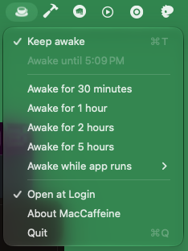

<p align="center">
  
</p>

<p align="center">
  
  
  
</p>

A tiny menu-bar app that keeps your Mac awake. One click. Filled cup = awake. ☕

<p align="center">
  
</p>

## Install

[Download the installer (dmg)](https://github.com/rgoomar/maccaffeine/releases/latest/download/MacCaffeine.dmg).

Or install with Homebrew:

```bash
brew install --cask rgoomar/tap/maccaffeine
```

All versions are on the [Releases](https://github.com/rgoomar/maccaffeine/releases) page.

## Use

Click the cup in the menu bar:

- **Keep awake**: stay awake until you turn it off.
- **Awake for 30 minutes / 1 / 2 / 5 hours**: stay awake, then turn off automatically.
- **Awake while app runs**: pick a running app. MacCaffeine turns off when that app quits.
- **Open at Login**: start MacCaffeine when you log in.
- **About MacCaffeine**: show the version and a link to this repository.

The menu shows the current state, the end time of a timer, or why it stopped.

## How it works

MacCaffeine holds the same power assertions as `caffeinate -dims`:

- No admin password and no changes to system settings.
- macOS releases the assertions when the app quits or crashes, so your Mac cannot get stuck awake.
- It turns off by itself when the battery is below 20% (on battery power) or when the Mac is critically hot.

> [!NOTE]
> With the lid closed, macOS stays awake only on the power adapter with an external display connected. On battery, closing the lid puts the Mac to sleep.

## MacCaffeine vs `caffeinate`

Both keep the Mac awake with the same power assertions. MacCaffeine adds controls and safety limits.

| | `caffeinate` | MacCaffeine |
|---|---|---|
| Sleep prevention | Same assertions | Same assertions |
| How you start it | Terminal command | Click the menu bar icon |
| Visible state | None. Check `pmset -g assertions`. | Filled cup when on. The menu shows the state and the end time. |
| Timer | `-t 3600` (seconds). You cannot see the time left. | 30 min, 1, 2, or 5 hours. The menu shows the end time. |
| Turn off | Ctrl-C, or find and kill the process | One click |
| Stay awake while an app runs | `caffeinate -w <pid>` | Pick the app from the menu |
| Stay awake while a command or CLI process runs | `caffeinate make`, `caffeinate -w <pid>` | No (the App Sandbox hides non-app processes) |
| Low battery | Keeps running until the battery is empty | Turns off below 20% on battery |
| Critical heat | Keeps running | Turns off |
| Start at login | Needs a LaunchAgent | Menu item |
| Use in scripts | Yes | No |
| Install | Comes with macOS | Separate app |

## Build from source

Requires the Xcode Command Line Tools (`xcode-select --install`).

```bash
./build.sh
open MacCaffeine.app
```

Local builds are ad-hoc signed. The app runs in the App Sandbox with the hardened runtime, as the Mac App Store requires.

## Credits

MacCaffeine started as a fork of [CaffeineOSS](https://github.com/Kuberwastaken/caffeineOSS) by Kuber Mehta. It now uses a different approach (no admin rights, no `pmset`), so it is a separate project.

## License

MIT. See [LICENSE](LICENSE).
